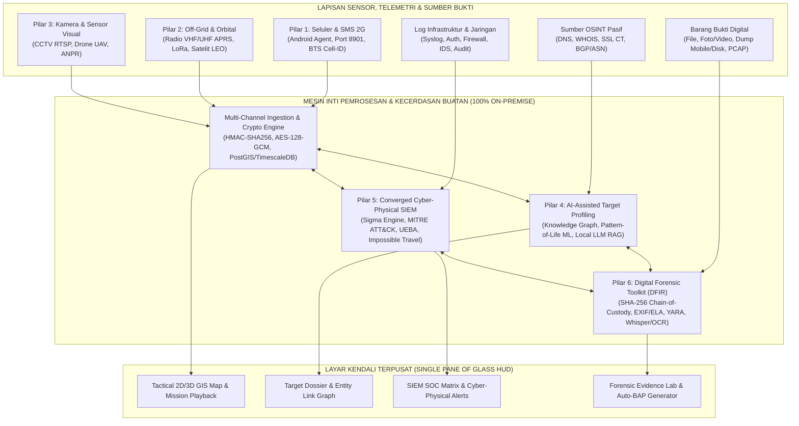
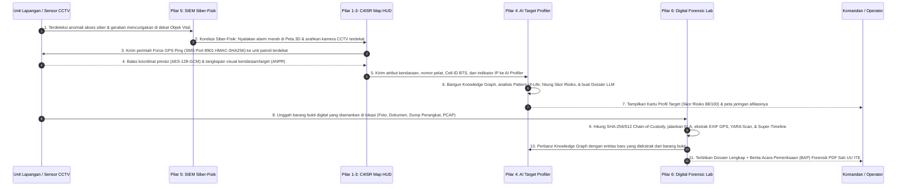

# DOKUMEN KEBUTUHAN BISNIS (*BUSINESS REQUIREMENTS DOCUMENT* / BRD)
## PLATFORM KOMANDO TAKTIS MULTI-KANAL, PEMROFILAN TARGET BERBASIS AI, SIEM SIBER-FISIK, DAN LABORATORIUM FORENSIK DIGITAL TERPADU
### **"TFAEL-OMNI v2.0: CONVERGED C4ISR, AI TARGET PROFILING, CYBER-PHYSICAL SIEM & DFIR PLATFORM"**

---

| Informasi Dokumen | Keterangan Resmi |
| :--- | :--- |
| **Kode Dokumen** | BRD/TFAEL-OMNI/X/2026/002 |
| **Versi Dokumen** | 2.0 (Edisi Terpadu: C4ISR + AI Profiling + SIEM + Digital Forensics) |
| **Tanggal Terbit** | 22 Oktober 2026 |
| **Klasifikasi** | TERBATAS (*RESTRICTED / OFFICIAL USE ONLY*) |
| **Pemilik Proses Bisnis** | Pusat Komando Operasi, Direktorat Keamanan Siber & Sandi, serta Tim Investigasi/Forensik Digital |
| **Status Dokumen** | *Final Draft — Siap Review & Persetujuan* |

---

## DAFTAR ISI
1. **BAB I: PENDAHULUAN & KONTEKS BISNIS**
2. **BAB II: TUJUAN BISNIS & INDIKATOR KINERJA UTAMA (KPI)**
3. **BAB III: PEMANGKU KEPENTINGAN & MATRIKS PERAN PENGGUNA (RBAC)**
4. **BAB IV: RUANG LINGKUP PROYEK (IN-SCOPE & OUT-OF-SCOPE)**
5. **BAB V: ARSITEKTUR 6 PILAR KAPABILITAS UTAMA**
6. **BAB VI: SPESIFIKASI KEBUTUHAN FUNGSIONAL (*FUNCTIONAL REQUIREMENTS*)**
7. **BAB VII: ALUR PROSES BISNIS & SKENARIO OPERASIONAL TERPADU (*USE CASES*)**
8. **BAB VIII: KEBUTUHAN NON-FUNGSIONAL (*NON-FUNCTIONAL REQUIREMENTS*)**
9. **BAB IX: KEBUTUHAN INFRASTRUKTUR, TEKNOLOGI, & MODEL DATA**
10. **BAB X: TAHAPAN IMPLEMENTASI & KRITERIA PENERIMAAN (*UAT ACCEPTANCE CRITERIA*)**

---

## BAB I: PENDAHULUAN & KONTEKS BISNIS

### 1.1 Latar Belakang Bisnis
Dalam penyelenggaraan operasi strategis instansi—meliputi pengamanan wilayah, pelindungan objek vital nasional, pencarian dan pertolongan (*Search and Rescue*), penanggulangan insiden siber, hingga penegakan hukum berbasis bukti elektronik—pimpinan dan operator menghadapi tantangan besar akibat **terpisahnya sistem pemantauan fisik dan sistem keamanan siber (*operational & intelligence silos*)**.

Berdasarkan evaluasi operasional saat ini, terdapat **6 (enam) kesenjangan utama (*business gaps*)** yang harus diselesaikan:
1. **Lumpuhnya Pemantauan di Area Minim Sinyal & *Total Blank Spot*:** Sistem pelacakan konvensional sangat bergantung pada internet seluler (4G/5G), sehingga pusat komando kehilangan jejak personel ketika bertugas di ruang bawah tanah, gedung tertutup, area bencana, hutan belantara, pegunungan, atau perairan lepas tanpa menara BTS.
2. **Lambatnya Pemrofilan Entitas & Target Operasi (*Manual Target Profiling*):** Proses menggabungkan informasi jejak digital (*OSINT*), pola pergerakan fisik (*Pattern of Life*), rekaman visual CCTV/Drone, dan jaringan relasi entitas masih dilakukan secara manual lintas aplikasi, sehingga memakan waktu berhari-hari saat respons cepat dibutuhkan dalam hitungan menit.
3. **Ketiadaan Korelasi Antara Serangan Siber dan Situasi Fisik (*Disconnected SIEM*):** Sistem pemantauan keamanan jaringan (*SIEM*) konvensional hanya menampilkan log teks/IP tanpa konteks geospasial. Ketika infrastruktur kritis diserang secara siber atau terjadi pembajakan akun personel, operator tidak dapat langsung mengorelasikannya dengan posisi fisik personel/aset di lapangan.
4. **Kerentanan Integritas Barang Bukti Digital (*Chain of Custody Gap*):** Proses pengumpulan bukti digital dari perangkat lapangan, rekaman video, dokumen, maupun log insiden belum terintegrasi langsung ke dalam brankas bukti digital berantai hash (*immutable evidence vault*), sehingga berisiko gugur sebagai alat bukti sah di pengadilan.
5. **Beban Analisis Operator yang Berlebihan (*Alert & Data Fatigue*):** Ribuan log peristiwa keamanan, aliran video kamera pengawas, dan titik koordinat masuk secara bersamaan tanpa penyaringan cerdas berbasis Kecerdasan Buatan (*Artificial Intelligence*).
6. **Risiko Kedaulatan Data (*Data Sovereignty Risk*):** Ketergantungan pada layanan *cloud* pihak ketiga atau API AI publik berisiko membocorkan data operasi sensitif dan membuat sistem lumpuh saat jaringan internet eksternal terputus.

### 1.2 Solusi Bisnis yang Diajukan
Membangun **Platform TFAEL-OMNI v2.0**, sebuah ekosistem **Pusat Komando Terpadu (*Single Pane of Glass*)** yang beroperasi **100% *On-Premise / Air-Gapped Ready*** dan menyatukan **6 Pilar Strategis**:
1. **Pilar 1 — *Cellular & SMS C2 Eye*:** Pelacakan perangkat dinas via Data 4G/5G dengan *auto-failover* ke SMS Biner Terenkripsi (Port 8901) dan triangulasi menara BTS.
2. **Pilar 2 — *Off-Grid & Orbital Eye*:** Pelacakan medan ekstrem tanpa BTS melalui gelombang radio VHF/UHF (APRS), jaringan *mesh* LoRa, dan satelit LEO.
3. **Pilar 3 — *Visual & Spatial AI Eye*:** Analitik video *real-time* (CCTV/Drone), deteksi atribut visual, pembacaan pelat nomor (ANPR), *Person/Vehicle Re-Identification*, dan *Geofencing*.
4. **Pilar 4 — *AI-Assisted Target & Entity Profiling*:** Pemrofilan otomatis entitas/target yang menggabungkan rekognisi pasif OSINT, grafik keterkaitan (*Knowledge Graph*), analisis pola perilaku ruang-waktu (*Pattern-of-Life*), skor ancaman dinamis, dan pembuatan *Target Dossier* otomatis menggunakan *Local LLM*.
5. **Pilar 5 — *Converged Cyber-Physical SIEM*:** Manajemen log dan deteksi insiden keamanan siber berbasis aturan *Sigma* dan matriks **MITRE ATT&CK**, analitik perilaku pengguna (*UEBA*), korelasi posisi fisik vs aktivitas siber (*Impossible Travel*), serta respons insiden otomatis (*SOAR Lite*).
6. **Pilar 6 — *Digital Forensic Toolkit (DFIR) & Evidence Vault*:** Akuisisi dan *triage* forensik perangkat/dokumen/multimedia/jaringan, deteksi manipulasi citra (*ELA/Deepfake*), transkripsi suara & OCR luring, serta penyimpanan barang bukti berantai hash SHA-256/SHA-512 yang menghasilkan Berita Acara Pemeriksaan (BAP) Forensik otomatis.

### 1.3 Landasan Hukum & Kepatuhan Regulasi
1. **UU No. 11 Tahun 2008 jo. UU No. 1 Tahun 2024 tentang Informasi dan Transaksi Elektronik (UU ITE):** Khususnya Pasal 5 dan Pasal 6 mengenai syarat keabsahan, keutuhan, dan ketersediaan Alat Bukti Elektronik.
2. **UU No. 27 Tahun 2022 tentang Pelindungan Data Pribadi (UU PDP):** Pemrosesan data secara sah, terbatas, terenkripsi, dan berorientasi pada keamanan nasional/kedinasan.
3. **Perpres No. 95 Tahun 2018 tentang Sistem Pemerintahan Berbasis Elektronik (SPBE).**
4. **Perpres No. 82 Tahun 2022 tentang Pelindungan Infrastruktur Informasi Vital (IIV).**
5. **Peraturan BSSN No. 4 Tahun 2021:** Tentang Pedoman Manajemen Keamanan Informasi SPBE dan Standar Teknis dan Prosedur Keamanan SPBE.
6. **SNI ISO/IEC 27037 & ISO/IEC 27042:** Standar internasional identifikasi, pengumpulan, akuisisi, preservasi, dan analisis bukti digital.

---

## BAB II: TUJUAN BISNIS & INDIKATOR KINERJA UTAMA (KPI)

| Kode Tujuan | Tujuan Bisnis Strategis (*Business Objective*) | Indikator Kinerja Utama (*Key Performance Indicator*) | Target Kuantitatif |
| :---: | :--- | :--- | :--- |
| **BO-01** | **Mewujudkan Visibilitas Operasional Lintas Medan (*Zero Blind-Spot*)** | Persentase kontinuitas pemantauan posisi personel/aset di wilayah ber-BTS (Data/SMS) dan wilayah tanpa BTS (Radio/Satelit). | **100%** (Area Ber-BTS) **> 95%** (Area Tanpa BTS) |
| **BO-02** | **Mempercepat Akuisisi Lokasi Darurat (*Rapid Emergency Location*)** | Waktu rata-rata sejak tombol *Force GPS Ping* ditekan hingga koordinat terbaru tampil di peta komando via SMS Terenkripsi. | **< 35 Detik** |
| **BO-03** | **Otomatisasi Pemrofilan Target & Entitas (*AI Target Profiling*)** | Pengurangan waktu penyusunan profil lengkap target (*Dossier* OSINT + Pola Pergerakan + Grafik Relasi) dari berhari-hari menjadi instan. | **< 60 Detik** per *Target Dossier* |
| **BO-04** | **Deteksi & Respons Cepat Insiden Siber-Fisik (*Cyber-Physical SIEM*)** | *Mean Time to Detect (MTTD)* untuk anomali keamanan siber, pelanggaran *geofence*, dan anomali *Impossible Travel*. | **< 3 Detik** (*Real-Time Alerting*) |
| **BO-05** | **Menjamin Keabsahan & Keutuhan Alat Bukti Forensik Digital** | Persentase barang bukti digital yang terverifikasi utuh dengan tanda tangan kriptografi SHA-256/SHA-512 & tercatat pada *Chain-of-Custody Ledger*. | **100%** (*Court-Admissible*) |
| **BO-06** | **Menjamin Kedaulatan Data & Kemandirian Operasional** | Kemampuan seluruh modul (Peta, AI/LLM, SIEM, Forensik) beroperasi penuh tanpa koneksi internet eksternal (*Air-Gapped*). | **100% Mandiri (*On-Premise*)** |

---

## BAB III: PEMANGKU KEPENTINGAN & MATRIKS PERAN PENGGUNA (RBAC)

Sistem menerapkan kontrol akses berbasis peran (*Role-Based Access Control*) dengan prinsip *Least Privilege* dan *Multi-Factor Authentication (MFA)*:

| Peran Pengguna (*Role*) | Deskripsi Tanggung Jawab | Hak Akses Modul Utama |
| :--- | :--- | :--- |
| **1. Pimpinan / Komandan Operasi (*Mission Commander*)** | Pengambil keputusan strategis, pemantau kesiapsiagaan operasi, dan pemberi otorisasi tingkat tinggi. | • *Executive C4ISR Dashboard* & *Mission Playback* • *Target Dossier & Risk Summary* • Laporan Eksekutif SIEM & BAP Forensik (Read-Only) |
| **2. Operator Pusat Komando (*C2 Tactical Operator*)** | Pengendali operasional harian pemantauan posisi personel, komunikasi radio/SMS darurat, dan pemantauan CCTV/Drone. | • Peta Taktis 2D/3D & *Geofencing* • Eksekusi *1-Click Force GPS Ping* (SMS Port 8901) • Pemantauan *Off-Grid* (APRS/LoRa/Satelit) & *Live Video AI* |
| **3. Analis Intelijen & Pemrofilan (*Intelligence & Profiling Analyst*)** | Melakukan pemrofilan entitas/target, analisis pola hidup (*Pattern-of-Life*), korelasi OSINT, dan analisis jaringan relasi. | • *AI-Assisted Target Profiling Engine* • *Entity Knowledge Graph & Link Analysis* • *Spatio-Temporal Behavioral Analytics* & *AI Analyst Copilot* |
| **4. Analis Keamanan Siber (*SOC / SIEM Analyst*)** | Memantau keamanan jaringan/server/endpoint, menganalisis *alert* MITRE ATT&CK, dan mengeksekusi mitigasi insiden siber. | • *Converged Cyber-Physical SIEM Dashboard* • *Sigma Rule Manager*, *UEBA*, & *SOAR Playbook Execution* • Korelasi *Impossible Travel* & Audit Keamanan Perangkat |
| **5. Investigator Forensik Digital (*DFIR Examiner*)** | Mengakuisisi, memeriksa, memulihkan, dan menyegel barang bukti digital untuk kebutuhan investigasi dan hukum. | • *Digital Forensic Toolkit (Mobile, Disk, Multimedia, PCAP)* • *Immutable Evidence Vault & Chain-of-Custody Ledger* • Generator Berita Acara Pemeriksaan (BAP) Forensik PDF |
| **6. Personel / Unit Lapangan (*Field Operative*)** | Personel di lapangan yang membawa perangkat dinas Android dan/atau perangkat radio taktis. | • *TFAEL Android Endpoint Agent* (Tombol SOS, Status Koneksi) • Transmisi Telemetri Otomatis (Data / SMS / APRS / LoRa) |

---

## BAB IV: RUANG LINGKUP PROYEK (*PROJECT SCOPE*)

### 4.1 Lingkup Pekerjaan yang Dilaksanakan (*In-Scope*)
1. **Pengembangan Antarmuka Pusat Komando Terpadu (*Unified Web GIS & Tactical HUD*):** Peta taktis 2D/3D luring (*offline vector tiles*), panel *multi-workspace* (Tactical Map, Target Profiler, SIEM SOC, Forensic Lab), *Time-Slider Mission Playback*, dan pelaporan PDF otomatis.
2. **Pengembangan Gerbang Telemetri Multi-Kanal & Mesin Kriptografi (*Multi-Channel C2 Gateway*):** Layanan *ingestion* HTTP/WebSocket, gateway SMS Biner Port 8901 ber-tanda tangan HMAC-SHA256 & enkripsi balasan AES-128-GCM, resolver lokasi menara BTS (*Cell-ID Geolocation*), serta dekoder radio APRS (AX.25), LoRa MQTT, dan webhook satelit LEO.
3. **Pengembangan Aplikasi Agen Perangkat Dinas (*TFAEL Android Endpoint Agent*):** Aplikasi Kotlin berstandar *Android Enterprise Device Owner* dengan fitur *Silent Force GPS Activation*, *Direct Boot Awareness*, deteksi manipulasi perangkat (*Root/Tamper Check*), dan hemat baterai (*0% Idle CPU Drain*).
4. **Pengembangan Modul Analitik Visual & Spasial AI (*Visual & Spatial AI Eye*):** Konverter *stream* RTSP ke WebRTC, deteksi & penghitungan objek *real-time* (YOLOv8), pembaca pelat nomor otomatis (ANPR/LPR), *Person/Vehicle Re-Identification* berbasis atribut visual, dan *Geofencing Engine*.
5. **Pengembangan Modul Pemrofilan Target Berbantuan AI (*AI-Assisted Target Profiling*):** Mesin pengumpul OSINT pasif, *Entity Resolution & Knowledge Graph*, algoritma deteksi *Pattern-of-Life* & *Co-Location/Rendezvous*, kalkulator skor ancaman dinamis (0–100), serta asisten analis berbasis *Local LLM* (*On-Premise RAG*).
6. **Pengembangan Modul SIEM Siber-Fisik (*Converged Cyber-Physical SIEM*):** Kolektor log multi-sumber, mesin deteksi berbasis aturan *Sigma* & matriks **MITRE ATT&CK**, analitik perilaku pengguna/entitas (*UEBA*), deteksi *Impossible Travel* (korelasi IP login vs lokasi GPS/BTS fisik), dan aksi respons cepat (*SOAR Lite*).
7. **Pengembangan Modul Forensik Digital (*Digital Forensic Toolkit / DFIR*):** Brankas bukti digital berantai hash (SHA-256/SHA-512), alat *triage* artefak perangkat mobile/SQLite, pemindai malware/spyware berbasis *YARA*, analisis keaslian foto/dokumen (*EXIF Geolocation Plotter* & *Error Level Analysis / ELA*), transkripsi audio (*Offline Whisper*) & OCR (*PaddleOCR*), analisis PCAP jaringan, serta *Unified Forensic Super-Timeline*.

### 4.2 Batasan Pekerjaan (*Out-of-Scope*)
Untuk menjamin kepatuhan hukum penuh dan fokus pelaksanaan proyek:
1. **Tanpa Penyadapan Ilegal (*No Unlawful Interception*):** Sistem tidak melakukan penyadapan protokol seluler ilegal (seperti eksploitasi SS7/Diameter) terhadap masyarakat umum. Pelacakan aktif hanya bekerja pada perangkat dinas resmi yang terdaftar (*authorized endpoints*).
2. **Rekognisi Siber Bersifat Pasif & Defensif:** Modul OSINT dan pemrofilan tidak melakukan peretasan aktif, eksploitasi destruktif, atau serangan *Denial of Service* terhadap sistem pihak ketiga.
3. **Penyediaan Satelit Fisik:** Proyek mencakup integrasi perangkat penerima stasiun bumi/terminal satelit dan radio, namun tidak mencakup pembuatan atau peluncuran wahana satelit ke orbit.

---

## BAB V: ARSITEKTUR 6 PILAR KAPABILITAS UTAMA

---

## BAB VI: SPESIFIKASI KEBUTUHAN FUNGSIONAL (*FUNCTIONAL REQUIREMENTS*)

Prioritas menggunakan metode **MoSCoW**:
* **M (*Must Have*):** Wajib tersedia pada rilis operasional.
* **S (*Should Have*):** Sangat direkomendasikan untuk meningkatkan nilai taktis.

### 6.1 Modul Pusat Komando & Peta Taktis (*Command Center Web GIS HUD*)
| Kode FR | Nama Kebutuhan | Deskripsi Kebutuhan Fungsional | Prioritas |
| :---: | :--- | :--- | :---: |
| **FR-HUD-01** | **Peta Taktis 2D/3D Luring (*Offline Vector Map*)** | Sistem harus mampu merender peta Indonesia 2D dan 3D (kontur medan & bangunan) secara luring (*offline*) tanpa ketergantungan pada internet publik, dengan kemampuan menampilkan minimal 1.000 aset bergerak secara *real-time* (60 FPS). | **M** |
| **FR-HUD-02** | **Indikator Multi-Kanal Berbasis Warna** | Sistem harus membedakan status koneksi unit di peta secara visual: **Hijau** (Data 4G/5G), **Kuning** (Jalur Darurat SMS 2G/BTS), **Biru** (Jalur Radio APRS/LoRa/Satelit), dan **Merah Berkedip** (SOS / Pelanggaran Geofence / Insiden Siber Kritis). | **M** |
| **FR-HUD-03** | **Time-Slider Mission Playback** | Operator harus dapat memutar ulang pergerakan seluruh personel, kemunculan target, alarm SIEM, dan posisi temuan bukti forensik pada rentang waktu historis tertentu dengan kontrol kecepatan (1x, 2x, 5x, 10x). | **M** |
| **FR-HUD-04** | **Geofencing Dinamis & Alarm Instan** | Operator dapat menggambar poligon zona operasi (*Zona Aman / Zona Terlarang*) di atas peta. Sistem wajib membunyikan alarm visual dan suara dalam waktu `< 1 detik` apabila unit/target masuk atau keluar dari batas zona. | **M** |

### 6.2 Modul Pengawasan Seluler, SMS Terenkripsi & Agen Lapangan (*Pilar 1*)
| Kode FR | Nama Kebutuhan | Deskripsi Kebutuhan Fungsional | Prioritas |
| :---: | :--- | :--- | :---: |
| **FR-CEL-01** | **1-Click Force GPS Ping via Binary SMS** | Operator dapat menekan tombol *Force GPS Ping* pada unit yang kehilangan koneksi internet. Server mengirimkan SMS Biner ke Port `8901` yang ditandatangani dengan **HMAC-SHA256** beserta *Timestamp* dan *Anti-Replay Nonce*. | **M** |
| **FR-CEL-02** | **Silent GPS Activation (Device Owner)** | Aplikasi Android Agent yang berjalan dalam mode *Device Owner* wajib memverifikasi tanda tangan HMAC-SHA256 dari SMS yang masuk. Jika valid, agen otomatis menyalakan modul GPS perangkat, mengambil titik koordinat presisi, dan mengirimkannya kembali. | **M** |
| **FR-CEL-03** | **Balasan Telemetri Terenkripsi AES-128-GCM** | Apabila koneksi data seluler masih terputus, perangkat mengirimkan balik koordinat GPS, level baterai, kecepatan, dan identitas menara BTS (`MCC/MNC/LAC/CID`) melalui SMS terenkripsi **AES-128-GCM** ke Pusat Komando. | **M** |
| **FR-CEL-04** | **Fallback Triangulasi Menara BTS (*Cell-ID Geolocation*)** | Jika personel berada di dalam ruangan tertutup tanpa sinyal satelit GPS, sistem wajib mengekstrak parameter `MCC/MNC/LAC/CID` dan kekuatan sinyal (`RSSI`) untuk menampilkan estimasi lingkaran probabilitas lokasi menara BTS di atas peta. | **M** |

### 6.3 Modul Pengawasan Medan Ekstrem & Orbital (*Pilar 2*)
| Kode FR | Nama Kebutuhan | Deskripsi Kebutuhan Fungsional | Prioritas |
| :---: | :--- | :--- | :---: |
| **FR-OFF-01** | **Dekoder Radio VHF/UHF APRS (AX.25)** | Sistem wajib memiliki layanan *bridge* yang menerima paket suara/data radio VHF/UHF dari perangkat *Transceiver/SDR* melalui TNC (*Direwolf*), mendekode koordinat APRS, dan menampilkannya langsung di peta utama. | **M** |
| **FR-OFF-02** | **Integrasi Jaringan LoRa Meshtastic** | Sistem wajib dapat menerima paket posisi dan pesan pendek dari jaringan radio *mesh* LoRa melalui broker MQTT internal untuk operasi tim di hutan atau kawasan tanpa BTS. | **M** |
| **FR-OFF-03** | **Integrasi Telemetri Satelit LEO** | Sistem wajib menyediakan *endpoint ingestion* untuk menerima *payload* koordinat dari perangkat komunikator satelit LEO (seperti Iridium / Garmin inReach) bagi unit di laut lepas atau pegunungan ekstrem. | **S** |

### 6.4 Modul Analitik Visual & Spasial AI (*Pilar 3*)
| Kode FR | Nama Kebutuhan | Deskripsi Kebutuhan Fungsional | Prioritas |
| :---: | :--- | :--- | :---: |
| **FR-VIS-01** | **Streaming Video Latensi Rendah (WebRTC)** | Sistem wajib mengonversi aliran video RTSP dari CCTV statis maupun kamera Drone (UAV) menjadi *WebRTC* berlatensi rendah (`< 500 ms`) yang dapat diputar langsung sebagai *picture-in-picture* di atas peta. | **M** |
| **FR-VIS-02** | **Deteksi & Penghitungan Objek AI (YOLOv8)** | Mesin visi komputer wajib mendeteksi, mengklasifikasikan, dan menghitung jumlah manusia, kendaraan (mobil, motor, truk), serta objek taktis secara otomatis dari aliran video. | **M** |
| **FR-VIS-03** | **Pembacaan Pelat Nomor Otomatis (ANPR/LPR)** | Sistem harus dapat mengekstrak nomor polisi kendaraan yang tertangkap kamera menggunakan OCR (*PaddleOCR*) dan mencocokkannya dengan daftar pantau (*Watchlist* target) secara *real-time*. | **M** |
| **FR-VIS-04** | **Pencarian Atribut Visual & Re-Identification (Re-ID)** | Analis dapat melakukan pencarian lintas kamera berdasarkan atribut visual objek (misal: warna pakaian, ransel, jenis/warna kendaraan) untuk merunut pergerakan target dari satu titik CCTV ke titik CCTV lainnya. | **S** |

### 6.5 Modul AI-Assisted Target & Entity Profiling (*Pilar 4*)
| Kode FR | Nama Kebutuhan | Deskripsi Kebutuhan Fungsional | Prioritas |
| :---: | :--- | :--- | :---: |
| **FR-PRF-01** | **Rekognisi Pasif OSINT & Pemetaan Infrastruktur** | Sistem wajib mampu mengumpulkan dan memetakan informasi pasif terkait domain, alamat IP, catatan DNS/WHOIS, log *Certificate Transparency (SSL)*, struktur jaringan BGP/ASN, dan indikasi keterpaparan port/kredensial. | **M** |
| **FR-PRF-02** | **Entity Resolution & Knowledge Graph Otomatis** | Sistem wajib menggabungkan data entitas (Orang, Perangkat, Nomor Telepon/Callsign, Kendaraan, Lokasi, Domain/IP, Bukti Forensik) ke dalam grafik hubungan interaktif (*Knowledge Graph*) dan mendeteksi keterkaitan tersembunyi secara otomatis. | **M** |
| **FR-PRF-03** | **Analisis Pola Perilaku Ruang-Waktu (*Pattern of Life*)** | Mesin ML (*HDBSCAN & Isolation Forest*) wajib menganalisis riwayat koordinat untuk menentukan titik kumpul rutin (*dwell locations*), jam aktif, rute kebiasaan, serta membunyikan peringatan otomatis apabila terjadi anomali perilaku pergerakan. | **M** |
| **FR-PRF-04** | **Deteksi Pertemuan & Pergerakan Bersama (*Co-Location & Rendezvous*)** | Sistem wajib mendeteksi secara otomatis apabila dua atau lebih entitas target berada pada koordinat geografis atau *Cell-ID* BTS yang sama dalam jendela waktu yang berdekatan. | **M** |
| **FR-PRF-05** | **Kalkulasi Skor Risiko/Ancaman Dinamis (0–100)** | Setiap entitas profil wajib memiliki **Skor Risiko (0–100)** yang dihitung secara transparan (*explainable*) berdasarkan faktor kerentanan siber, anomali pergerakan spasial, afiliasi jaringan, dan temuan forensik. | **M** |
| **FR-PRF-06** | **Generator Dossier Target Berbasis Local LLM** | Menggunakan *Local LLM* yang berjalan di server internal, sistem harus dapat menyusun laporan **Kartu Profil Target (*Target Dossier PDF*)** berbahasa Indonesia secara otomatis beserta ringkasan eksekutif dan rekomendasi tindakan. | **M** |

### 6.6 Modul Converged Cyber-Physical SIEM & SOAR Lite (*Pilar 5*)
| Kode FR | Nama Kebutuhan | Deskripsi Kebutuhan Fungsional | Prioritas |
| :---: | :--- | :--- | :---: |
| **FR-SIM-01** | **Ingesti & Normalisasi Log Terpusat** | Sistem wajib menerima dan menormalisasi log keamanan dari server Linux/Windows, Firewall/IDS, aplikasi Pusat Komando, serta *SMS C2 Gateway* (termasuk deteksi paket SMS palsu/tanpa HMAC sah). | **M** |
| **FR-SIM-02** | **Mesin Deteksi Sigma & Pemetaan MITRE ATT&CK** | Sistem wajib mengevaluasi log secara *real-time* menggunakan aturan deteksi berformat **Sigma** dan memetakan setiap *alert* ke dalam matriks taktik dan teknik **MITRE ATT&CK** (misal: *Initial Access*, *Credential Access*, *Lateral Movement*). | **M** |
| **FR-SIM-03** | **Korelasi Siber-Fisik & Deteksi *Impossible Travel*** | Sistem wajib mengorelasikan lokasi geografis aktivitas siber (IP Login/Akses Server) dengan lokasi fisik perangkat personel (GPS/BTS/APRS). Jika akun personel login dari lokasi yang berbeda jauh dengan posisi fisiknya di peta, sistem otomatis memicu alarm *Account Compromise / Impossible Travel*. | **M** |
| **FR-SIM-04** | **Analitik Perilaku Pengguna & Entitas (UEBA)** | Sistem wajib mendeteksi aktivitas abnormal pengguna internal, seperti pengunduhan data massal di luar jam kerja, percobaan eskalasi hak akses, atau akses ke profil target di luar kewenangannya. | **M** |
| **FR-SIM-05** | **Respons Insiden Cepat (*SOAR Lite Playbooks*)** | Operator SOC dapat mengeksekusi tindakan mitigasi *1-Click* (atau otomatis untuk level kritis): memblokir IP penyerang, membekukan sesi pengguna, mengisolasi perangkat, dan langsung memicu pembekuan bukti ke modul Forensik Digital. | **M** |

### 6.7 Modul Digital Forensic Toolkit (DFIR) & Evidence Vault (*Pilar 6*)
| Kode FR | Nama Kebutuhan | Deskripsi Kebutuhan Fungsional | Prioritas |
| :---: | :--- | :--- | :---: |
| **FR-DFR-01** | **Brankas Bukti Digital & *Chain-of-Custody Ledger*** | Setiap file bukti yang diunggah/diakuisisi wajib dihitung nilai hash **SHA-256 dan SHA-512**-nya secara otomatis, diberi *timestamp*, dan dicatat dalam buku besar berantai hash (*hash-chained audit log*) yang tidak dapat diubah untuk memenuhi syarat Pasal 5 & 6 UU ITE. | **M** |
| **FR-DFR-02** | **Forensik Citra, Dokumen, & Pemetaan EXIF Otomatis** | Sistem wajib mengekstrak metadata tersembunyi (EXIF GPS, seri kamera, pembuat dokumen, riwayat aplikasi edit) dari foto/video/dokumen bukti, memplot lokasi pengambilan foto langsung ke Peta Taktis, serta menjalankan **Error Level Analysis (ELA)** untuk mendeteksi indikasi rekayasa/manipulasi gambar. | **M** |
| **FR-DFR-03** | **Triage Forensik Perangkat Mobile & Pemulihan SQLite** | Sistem wajib mampu menganalisis artefak perangkat Android/Mobile (log panggilan, SMS, riwayat lokasi, APK terinstal) serta memindai file database `.sqlite` / `-wal` untuk memulihkan rekaman pesan atau log yang telah dihapus. | **M** |
| **FR-DFR-04** | **Pemindai Malware, Spyware & IoC Berbasis YARA** | Sistem wajib menyediakan mesin pemindai berbasis aturan **YARA** dan pencocokan hash *Indicators of Compromise (IoC)* untuk mendeteksi keberadaan *malware*, *stalkerware*, atau *backdoor* pada file bukti maupun *dump* perangkat. | **M** |
| **FR-DFR-05** | **Forensik Audio-ke-Teks (Whisper) & OCR Luring** | Sistem wajib dapat mentranskripsikan rekaman suara bukti (komunikasi radio/telepon) menjadi teks secara luring menggunakan AI *Whisper*, serta mengekstrak teks dari foto dokumen menggunakan *OCR* agar seluruh kata kunci (NIK, nama, nomor HP, rekening) dapat dicari dalam hitungan detik. | **M** |
| **FR-DFR-06** | **Analisis Forensik Jaringan (PCAP) & *Super-Timeline*** | Sistem harus dapat membedah file rekaman jaringan (`.pcap`/`.pcapng`) untuk mengekstrak sesi komunikasi, DNS query, dan indikator C2, lalu menyatukan seluruh artefak (log server, GPS, mobile, file, PCAP) ke dalam satu **Garis Waktu Forensik Terpadu (*Unified Super-Timeline*)**. | **S** |
| **FR-DFR-07** | **Fusi Forensik-ke-Profil & Cetak BAP Otomatis** | Setiap entitas baru (nomor telepon, email, IP, koordinat GPS, pelat nomor) yang ditemukan saat pemeriksaan forensik wajib otomatis tertaut ke **Knowledge Graph Target Profiling**. Sistem juga wajib menghasilkan dokumen **Berita Acara Pemeriksaan (BAP) Forensik PDF** resmi siap cetak. | **M** |

---

## BAB VII: ALUR PROSES BISNIS & SKENARIO OPERASIONAL TERPADU (*USE CASES*)

Berikut adalah alur kerja terpadu (*End-to-End Converged Workflow*) yang menunjukkan bagaimana keenam pilar bekerja secara sinergis dalam satu skenario operasi nyata:

---

## BAB VIII: KEBUTUHAN NON-FUNGSIONAL (*NON-FUNCTIONAL REQUIREMENTS*)

| Kode NFR | Kategori | Spesifikasi Kebutuhan Non-Fungsional | Target Standar |
| :---: | :--- | :--- | :--- |
| **NFR-SEC-01** | **Keamanan Kriptografi** | Seluruh perintah C2 melalui SMS wajib menggunakan tanda tangan **HMAC-SHA256** (12 byte *truncated tag* + 4 byte *timestamp* + 2 byte *nonce*), dan enkripsi data balasan wajib menggunakan **AES-128-GCM**. Komunikasi web wajib menggunakan **TLS 1.3**. | 0% Perintah Tanpa Otorisasi (*Zero Spoofing*) |
| **NFR-SEC-02** | **Keutuhan Bukti & Log Audit** | Seluruh aktivitas operator, perubahan status, dan penyimpanan barang bukti forensik wajib dicatat dalam struktur *append-only hash-chained ledger* (`prev_hash` + `curr_hash` SHA-256). | 100% *Tamper-Evident* & *Court-Admissible* |
| **NFR-SOV-01** | **Kedaulatan Data (*Air-Gapped*)** | Seluruh komponen sistem—termasuk peta vektor, basis data lokasi BTS, model visi komputer (YOLOv8/OCR), model transkripsi suara (Whisper), dan model bahasa besar (*Local LLM*)—wajib berjalan di server internal tanpa mengirim data ke *cloud* eksternal. | 100% *On-Premise / Offline Capable* |
| **NFR-PRF-01** | **Kinerja & Latensi Sistem** | • Latensi pembaruan titik lokasi di peta: `< 300 ms`. • Latensi deteksi pelanggaran *Geofence*: `< 200 ms` di sisi server. • Kapasitas ingesti SIEM: minimal `5.000 EPS` (*Events Per Second*). • Kapasitas pemantauan serentak: minimal `1.000 unit aktif`. | Respons *Real-Time* Tanpa Jeda (*Zero Lag*) |
| **NFR-AVL-01** | **Ketersediaan Tinggi (*High Availability*)** | Sistem dirancang menggunakan arsitektur terkontainerisasi dengan mekanisme *auto-restart*, pencadangan basis data otomatis (*RAID 10 + Daily Snapshot*), dan ketahanan operasi 24/7/365. | *Uptime* **> 99,9%** |
| **NFR-END-01** | **Efisiensi Agen Perangkat Dinas** | Aplikasi Android Agent tidak boleh melakukan *polling* GPS terus-menerus saat kondisi pasif agar tidak menguras baterai personel di lapangan. | **0% Idle CPU Drain** (`< 2%` baterai/hari saat *standby*) |

---

## BAB IX: KEBUTUHAN INFRASTRUKTUR, TEKNOLOGI, & MODEL DATA

### 9.1 Spesifikasi Perangkat Lunak (*Open-Source Enterprise Stack — Bebas Biaya Lisensi Tahunan*)
| Lapisan Arsitektur | Teknologi yang Digunakan | Fungsi Utama |
| :--- | :--- | :--- |
| **Frontend Command HUD** | `React 18`, `TypeScript`, `TailwindCSS`, `MapLibre GL JS`, `Deck.gl`, `Cytoscape.js` | Antarmuka Peta Taktis 2D/3D, Grafik Relasi Target (*Knowledge Graph*), Dashboard SIEM MITRE ATT&CK, dan Meja Kerja Forensik Digital. |
| **Backend & Core Engine** | `Python (FastAPI)` & `Go` | Layanan API berkinerja tinggi, mesin kriptografi C2, mesin korelasi SIEM, orkestrator AI Target Profiling, dan pemroses forensik. |
| **Basis Data Terpadu** | `PostgreSQL 16` + `PostGIS` + `TimescaleDB` + `Apache AGE` + `pgvector` + `Redis` | Penyimpanan spasial (PostGIS), telemetri & log SIEM *time-series* (TimescaleDB), grafik relasi entitas (Apache AGE), pencarian vektor AI (pgvector), dan *message broker real-time* (Redis). |
| **Mesin AI & Analitik (On-Premise)** | `Ultralytics YOLOv8`, `PaddleOCR`, `Faster-Whisper`, `Scikit-Learn (HDBSCAN/IsolationForest)`, `Ollama / vLLM (Qwen-2.5 / Llama-3)` | Deteksi objek CCTV/Drone, pembacaan pelat nomor & OCR dokumen bukti, transkripsi audio forensik luring, deteksi anomali pola hidup, dan asisten LLM pembuat Dossier/BAP. |
| **Mesin Forensik & Keamanan** | `ExifTool`, `OpenCV (ELA)`, `YARA-python`, `Scapy/PyShark`, `Sigma Engine` | Ekstraksi metadata bukti, deteksi manipulasi foto, pemindaian *malware/IoC*, analisis paket jaringan PCAP, dan aturan deteksi SIEM. |
| **Gerbang Radio & Video** | `Direwolf (APRS AX.25)`, `Eclipse Mosquitto (LoRa MQTT)`, `MediaMTX (RTSP-to-WebRTC)` | Dekoder paket radio VHF/UHF, penerima telemetri LoRa, dan *streaming* video latensi rendah. |

### 9.2 Spesifikasi Perangkat Keras Server Pusat Komando (*On-Premise Server*)
* **Prosesor (CPU):** Minimal 16 Core / 32 Threads (Direkomendasikan 24–32 Core Kelas Server Xeon / EPYC).
* **Memori (RAM):** Minimal 64 GB ECC DDR4/DDR5 (untuk mendukung *in-memory graph*, SIEM *indexing*, dan inferensi AI lokal).
* **Penyimpanan (Storage):**
  * **Primary Fast Tier:** 2 TB NVMe SSD (RAID 1/10) untuk Database Spasial, Log SIEM Aktif, dan Peta Vektor Luring Seluruh Indonesia.
  * **Evidence & Archive Tier:** 4 TB – 8 TB Enterprise SSD/HDD (RAID 5/6) untuk Brankas Barang Bukti Forensik Digital (*Evidence Vault*) dan rekaman video insiden.
* **Akselerator AI (GPU):** 1x atau 2x NVIDIA GPU (Minimal 16 GB – 24 GB VRAM) untuk menjalankan inferensi *YOLOv8 Video AI*, *Whisper Audio Forensics*, dan *Local LLM Target Profiler* secara simultan.
* **Perangkat Gerbang Komunikasi:** Modem GSM/LTE Industrial (mendukung *AT+CMGS PDU Mode* / SMPP), Radio Transceiver VHF/UHF + Antarmuka Audio/TNC untuk APRS, dan Node Gateway LoRa Meshtastic.

---

## BAB X: TAHAPAN IMPLEMENTASI & KRITERIA PENERIMAAN (*UAT ACCEPTANCE CRITERIA*)

### 10.1 Peta Jalan Implementasi (16 Minggu / 4 Bulan)
| Tahap | Rentang Waktu | Fokus Pengembangan (*Deliverables*) |
| :---: | :---: | :--- |
| **Tahap I** | **Minggu 1 – 4** *(Bulan Ke-1)* | **Inti Pusat Komando, Peta Taktis, & C2 Seluler/SMS (Pilar 1 & 2):** Instalasi basis data terpadu, Dashboard Peta 2D/3D, *Force GPS Ping* via SMS Biner Port 8901 (HMAC/AES), Triangulasi BTS, aplikasi Android Agent, serta integrasi Radio APRS/LoRa. |
| **Tahap II** | **Minggu 5 – 8** *(Bulan Ke-2)* | **AI-Assisted Target Profiling & Analitik Video AI (Pilar 3 & 4):** Integrasi *streaming* CCTV/Drone WebRTC + YOLOv8 & ANPR, mesin rekognisi pasif OSINT, *Knowledge Graph* keterkaitan entitas, analisis *Pattern-of-Life*, dan generator *Target Dossier* berbasis *Local LLM*. |
| **Tahap III** | **Minggu 9 – 12** *(Bulan Ke-3)* | **Converged Cyber-Physical SIEM & SOAR Lite (Pilar 5):** Pembangunan kolektor log multi-sumber, mesin aturan *Sigma*, visualisasi matriks **MITRE ATT&CK**, analitik perilaku *UEBA*, dan deteksi korelasi siber-fisik (*Impossible Travel*). |
| **Tahap IV** | **Minggu 13 – 16** *(Bulan Ke-4)* | **Digital Forensic Toolkit (DFIR), Integrasi Penuh & UAT (Pilar 6):** Pembangunan *Immutable Evidence Vault* (SHA-256/512), modul forensik dokumen/citra (*EXIF/ELA*), *triage* perangkat mobile/SQLite, pemindai *YARA*, analisis PCAP, generator BAP Forensik PDF, pengujian beban 1.000 unit, dan pelatihan operator (Bimtek). |

### 10.2 Kriteria Penerimaan Pengujian (*User Acceptance Test / UAT Criteria*)
Sistem dinyatakan lulus uji kelayakan operasional apabila memenuhi seluruh skenario pengujian berikut:
1. **UAT-01 (C4ISR & Fallback SMS/Off-Grid):** Saat koneksi internet perangkat dinas dimatikan, perintah *Force GPS Ping* dari Pusat Komando berhasil menyalakan GPS perangkat melalui SMS Biner bertanda tangan HMAC-SHA256 dan memetakan posisi terbaru di layar peta dalam waktu `< 35 detik`.
2. **UAT-02 (Anti-Spoofing Security):** Paket SMS perintah yang dikirim tanpa tanda tangan HMAC-SHA256 yang sah wajib ditolak 100% oleh perangkat lapangan dan langsung memicu *alert* intrusi pada modul SIEM.
3. **UAT-03 (AI-Assisted Target Profiling):** Dari input satu indikator target (domain/IP/nomor/kendaraan), sistem mampu merender grafik keterkaitan entitas (*Knowledge Graph*), menampilkan analisis pola pergerakan (*Pattern of Life*), menghitung Skor Risiko (0–100), dan mengekspor dokumen *Target Dossier PDF* dalam waktu `< 60 detik`.
4. **UAT-04 (Converged Cyber-Physical SIEM):** Saat disimulasikan serangan siber (*Brute Force / Intrusion*) atau anomali login dari lokasi yang bertentangan dengan posisi GPS personel (*Impossible Travel*), sistem membunyikan alarm di bawah `3 detik`, memetakan teknik serangan ke matriks **MITRE ATT&CK**, dan menyorot lokasi fisik terkait di atas Peta Taktis 3D.
5. **UAT-05 (Digital Forensic Toolkit & Chain of Custody):** Saat investigator mengunggah barang bukti digital (foto ber-EXIF, dokumen, sampel file, atau rekaman jaringan), sistem berhasil:
   * Menghitung dan mengunci nilai hash SHA-256/SHA-512 ke dalam *hash-chained ledger*.
   * Mengekstrak koordinat EXIF foto dan memplotnya ke peta, serta mendeteksi area manipulasi gambar melalui *Error Level Analysis (ELA)*.
   * Memindai indikator berbahaya menggunakan aturan *YARA* dan menautkan temuan entitas baru ke profil target.
   * Mencetak dokumen **Berita Acara Pemeriksaan (BAP) Forensik PDF** lengkap dengan tanda bukti integritas kriptografi.

---

## LEMBAR PENGESAHAN DOKUMEN KEBUTUHAN BISNIS (BRD)

**Disusun di:** Jakarta  
**Pada Tanggal:** 22 Oktober 2026  

| Disusun Oleh, | Diperiksa Oleh, | Disetujui Oleh, |
| :---: | :---: | :---: |
| **Tim Arsitek Sistem & Analis Bisnis** | **Kepala Bidang Keamanan Siber, Intelijen & Forensik** | **Pejabat Pembuat Komitmen / Komandan Satuan Kerja** |
|    *( .................................................. )* NIP/NRP. ......................................... |    *( .................................................. )* NIP/NRP. ......................................... |    *( .................................................. )* NIP/NRP. ......................................... |
