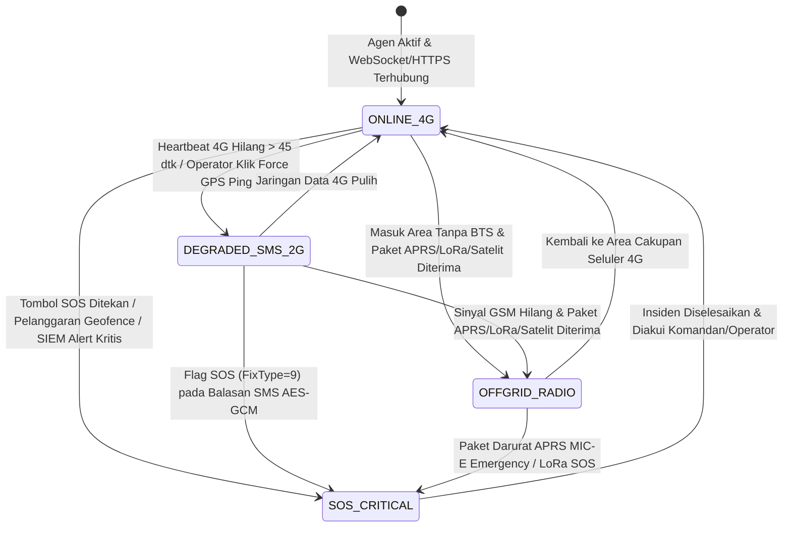

# DOKUMEN SPESIFIKASI KEBUTUHAN PERANGKAT LUNAK (*SOFTWARE REQUIREMENTS SPECIFICATION* / SRS)
## PLATFORM KOMANDO TAKTIS MULTI-KANAL, PEMROFILAN TARGET BERBASIS AI, SIEM SIBER-FISIK, DAN LABORATORIUM FORENSIK DIGITAL TERPADU
### **"TFAEL-OMNI v2.0: STANDAR IEEE 830 / ISO/IEC/IEEE 29148 ENGINEERING SPECIFICATION"**

---

| Informasi Dokumen | Keterangan Resmi |
| :--- | :--- |
| **Kode Dokumen** | SRS/TFAEL-OMNI/X/2026/004 |
| **Standar Acuan** | ISO/IEC/IEEE 29148:2018 & IEEE Std 830 (*Software Requirements Specifications*) |
| **Dokumen Terkait** | • BRD/TFAEL-OMNI/X/2026/002 (*Business Requirements Document*) • PRD/TFAEL-OMNI/X/2026/003 (*Product Requirements Document*) |
| **Versi Perangkat Lunak** | v2.0.0-GA (*On-Premise / Air-Gapped Microservices Architecture*) |
| **Tanggal Terbit** | 22 Oktober 2026 |
| **Klasifikasi** | TERBATAS (*RESTRICTED / ENGINEERING & OFFICIAL USE ONLY*) |
| **Penyusun Teknis** | Tim Arsitek Perangkat Lunak, Insinyur Kriptografi, Tim AI/ML, SOC & Forensik Digital |

---

## DAFTAR ISI
1. **BAB I: PENDAHULUAN (STANDAR ISO/IEC/IEEE 29148 §1)**
2. **BAB II: DESKRIPSI UMUM ARSITEKTUR PERANGKAT LUNAK (§2)**
3. **BAB III: SPESIFIKASI ANTARMUKA EKSTERNAL — HARDWARE, SOFTWARE, & KOMUNIKASI (§3)**
4. **BAB IV: SPESIFIKASI TEKNIS SUBSISTEM & LOGIKA PEMROSESAN (§4)**
5. **BAB V: MESIN STATUS (*STATE MACHINES*), SKEMA DDL, & INDEKS BASIS DATA**
6. **BAB VI: ATRIBUT KUALITAS PERANGKAT LUNAK (STANDAR ISO/IEC 25010)**
7. **BAB VII: MATRIKS KETERTELUSURAN KEBUTUHAN (*REQUIREMENTS TRACEABILITY MATRIX / RTM*)**

---

## BAB I: PENDAHULUAN (*INTRODUCTION*)

### 1.1 Tujuan Dokumen (*Purpose*)
Dokumen *Software Requirements Specification* (SRS) ini mendefinisikan spesifikasi rekayasa perangkat lunak secara lengkap, presisi, dan dapat diverifikasi untuk pembangunan platform **TFAEL-OMNI v2.0**. Dokumen ini menjadi acuan teknis mengikat bagi:
1. **Tim Rekayasa Backend & Kriptografi:** Dalam mengimplementasikan layanan mikro (*microservices*), protokol SMS Biner Port 8901, dekoder radio APRS/LoRa, mesin SIEM, dan brankas forensik.
2. **Tim Rekayasa Android (Endpoint Agent):** Dalam membangun agen perangkat dinas berbasis *Kotlin* dengan hak akses *Android Enterprise Device Owner*.
3. **Tim Rekayasa AI & Visi Komputer:** Dalam mengintegrasikan pipeline inferensi *YOLOv8*, *PaddleOCR*, *Faster-Whisper*, *HDBSCAN/IsolationForest*, serta *Local LLM (RAG)*.
4. **Tim Pengujian & Jaminan Mutu (QA/SecOps):** Dalam menyusun pengujian otomatis (*unit, integration, cryptographic, & load testing*) serta verifikasi kelayakan operasi (UAT).

### 1.2 Konvensi Penomoran & Prioritas Spesifikasi
Setiap kebutuhan perangkat lunak di dalam dokumen ini diberi kode unik dengan format **`SRS-<KATEGORI>-<NOMOR>`**:
* **`SRS-UI-*` / `SRS-HW-*` / `SRS-SW-*` / `SRS-COM-*`:** Spesifikasi Antarmuka Eksternal (*External Interfaces*).
* **`SRS-C2-*`:** Subsistem Komando Seluler, SMS Kriptografi, & Android Agent (Pilar 1).
* **`SRS-OFF-*`:** Subsistem Jembatan Komunikasi Off-Grid APRS, LoRa, & Satelit (Pilar 2).
* **`SRS-VIS-*`:** Subsistem Analitik Video AI, ANPR, Re-ID, & Spasial (Pilar 3).
* **`SRS-PRF-*`:** Subsistem AI-Assisted Target Profiling & Knowledge Graph (Pilar 4).
* **`SRS-SIM-*`:** Subsistem Converged Cyber-Physical SIEM & SOAR (Pilar 5).
* **`SRS-DFR-*`:** Subsistem Digital Forensic Toolkit & Chain-of-Custody Vault (Pilar 6).
* **`SRS-NFR-*`:** Spesifikasi Atribut Kualitas Non-Fungsional (ISO/IEC 25010).

### 1.3 Standar Teknis & RFC Acuan
Implementasi kode sumber wajib mematuhi spesifikasi protokol dan standar kriptografi berikut:
1. **RFC 2104 & FIPS 198-1:** *HMAC: Keyed-Hashing for Message Authentication (HMAC-SHA256)*.
2. **NIST SP 800-38D:** *Recommendation for Block Cipher Modes of Operation: Galois/Counter Mode (AES-128-GCM)*.
3. **3GPP TS 23.040 & TS 27.005:** *Technical Realization of the Short Message Service (SMS PDU Mode & Application Port Addressing 16-bit Header)*.
4. **AX.25 Link Access Protocol v2.2 & APRS v1.0.1:** Spesifikasi paket radio amatir/taktis VHF/UHF.
5. **RFC 5424:** *The Syslog Protocol* untuk ingesti peristiwa keamanan SIEM.
6. **MITRE ATT&CK® Framework v15 & Sigma Rule Specification v2.0:** Standar taksonomi ancaman dan aturan deteksi log.
7. **SNI ISO/IEC 27037:2014 & FIPS 180-4 (SHA-256 / SHA-512):** Akuisisi, preservasi, dan integritas kriptografi barang bukti digital.

---

## BAB II: DESKRIPSI UMUM ARSITEKTUR PERANGKAT LUNAK (*OVERALL DESCRIPTION*)

### 2.1 Topologi Layanan Mikro (*Microservices & Container Architecture*)
Perangkat lunak **TFAEL-OMNI v2.0** dirancang menggunakan arsitektur layanan mikro berbasis kontainer (*Docker Engine / Compose*) yang berkomunikasi melalui jaringan privat internal (`tfael_internal_net`) dengan pembagian 8 komponen layanan inti:

| Kode Layanan (*Container Name*) | Bahasa / Runtime | Port Internal | Tanggung Jawab Rekayasa Utama |
| :--- | :--- | :---: | :--- |
| **`ui-command-hud`** | React 18, TypeScript, Vite, Nginx | `8443` (TLS) | Menyajikan aplikasi *Single-Page Application (SPA)* 4-Workspace (Peta 3D MapLibre/Deck.gl, Target Profiler Cytoscape, SIEM Console, dan Forensic Lab). |
| **`svc-api-orchestrator`** | Python 3.12 (FastAPI / Uvicorn) | `8000` | Gerbang API utama (`/api/v2/*`), manajemen autentikasi JWT/RBAC, orkestrasi WebSocket (`/ws/v2/*`), dan pencatatan *Hash-Chained Audit Log*. |
| **`svc-c2-crypto-gateway`** | Go 1.22 / Python | `8010` | Mesin kriptografi `HMAC-SHA256` & `AES-128-GCM`, pengendali modem GSM Serial (`AT+CMGS PDU`) / SMPP, dan resolver lokasi menara BTS. |
| **`svc-offgrid-bridge`** | Go 1.22 + Direwolf TNC | `8020` | *Daemon* penerima paket radio VHF/UHF APRS (`KISS TCP 8001`), pelanggan broker MQTT LoRa Meshtastic (`Port 1883`), dan *webhook* satelit LEO. |
| **`svc-vision-spatial`** | Python 3.12 + PyTorch CUDA + MediaMTX | `8030` / `8554` | Konversi RTSP ke WebRTC, inferensi GPU *YOLOv8 + BoT-SORT*, pembacaan pelat nomor (*PaddleOCR*), *Visual Re-ID*, dan evaluasi *PostGIS Geofence*. |
| **`svc-ai-profiler`** | Python 3.12 + Scikit-Learn + Ollama/vLLM | `8040` / `11434` | Rekognisi pasif OSINT, resolusi entitas ke *Apache AGE Graph*, klasterisasi ruang-waktu *HDBSCAN*, kalkulasi Skor Risiko, dan *Local LLM Dossier Generator*. |
| **`svc-cyber-siem`** | Python 3.12 / Go | `8050` / `5514` | Kolektor *Syslog/JSON*, mesin evaluator aturan *Sigma*, pemetaan **MITRE ATT&CK**, deteksi *Impossible Travel*, analitik *UEBA*, dan eksekutor *SOAR Lite*. |
| **`svc-dfir-toolkit`** | Python 3.12 + ExifTool + YARA + Whisper | `8060` | Akuisisi bukti digital berantai hash SHA-256/512, analisis citra *EXIF/ELA*, pemulihan record *SQLite WAL*, pemindaian *YARA*, transkripsi *Whisper/OCR*, & generator BAP PDF. |

### 2.2 Lingkungan Operasi (*Operating Environment*)
1. **Lingkungan Server Pusat Komando (*Host OS*):** Linux Ubuntu Server 22.04 / 24.04 LTS (`x86_64`), Kernel $\ge 5.15$, Docker Engine $\ge 26.0$, NVIDIA Container Toolkit dengan driver CUDA $\ge 12.2$.
2. **Lingkungan Klien Operator (*Client Browser*):** Peramban modern berbasis Chromium/Firefox dengan dukungan perangkat keras **WebGL 2.0** (untuk rendering peta 3D dan puluhan ribu titik Deck.gl) serta **WebRTC H.264**.
3. **Lingkungan Perangkat Lapangan (*Android Endpoint*):** Android OS versi 10 s/d 15 (API Level 29–35) yang diprovisikan sebagai **Android Enterprise Device Owner** (`dpm set-device-owner`), dilengkapi chip perangkat keras *Trusted Execution Environment (TEE) / StrongBox Keystore*.

---

## BAB III: SPESIFIKASI ANTARMUKA EKSTERNAL (*EXTERNAL INTERFACE REQUIREMENTS*)

### 3.1 Antarmuka Perangkat Keras (*Hardware Interfaces*)
| Kode SRS | Komponen Perangkat Keras | Spesifikasi Protokol & Parameter Teknis |
| :---: | :--- | :--- |
| **SRS-HW-01** | **Modem Seluler GSM/LTE Industrial (SMS C2)** | • **Koneksi Fisik:** USB Serial (`/dev/ttyUSB0`) atau RS-232 dengan parameter `115200 baud, 8 data bits, No parity, 1 stop bit (8N1)`. • **Mode Operasi:** Wajib diinisialisasi ke **PDU Mode** (`AT+CMGF=0`) dan mengaktifkan notifikasi pesan masuk langsung (`AT+CNMI=2,2,0,0,0`). • **Port Addressing:** Menggunakan *User Data Header (UDH)* `06 05 04 22 C5 22 C5` untuk mengarahkan paket biner langsung ke **Port `8901` (`0x22C5`)** tanpa masuk ke kotak masuk SMS reguler pengguna. |
| **SRS-HW-02** | **Penerima Radio VHF/UHF & TNC APRS** | • **Koneksi Fisik:** Radio Transceiver VHF (`144.390 MHz` / frekuensi taktis instansi) terhubung ke antarmuka audio USB/SDR. • **Demodulasi Software:** Layanan `Direwolf` mendemodulasi sinyal *AFSK 1200 baud / G3RUH 9600 baud* dan mengekspos antarmuka **KISS TNC over TCP** pada `127.0.0.1:8001`. |
| **SRS-HW-03** | **Gateway Jaringan LoRa Meshtastic** | • **Koneksi Fisik:** Perangkat LoRa (`433 MHz` / `915–923 MHz`) terhubung via USB Serial atau Wi-Fi lokal. • **Protokol Data:** Meneruskan paket `MeshPacket` berformat **Protocol Buffers (Protobuf)** ke broker MQTT internal pada topik `msh/ID/2/c/#` atau `msh/ID/2/json/#`. |
| **SRS-HW-04** | **Akselerator GPU NVIDIA (Inferensi AI)** | • **Antarmuka Driver:** Diakses melalui `CUDA Runtime API` dan `TensorRT / ONNX Runtime` dari dalam kontainer `svc-vision-spatial`, `svc-ai-profiler`, dan `svc-dfir-toolkit`. • **Alokasi Memori VRAM:** Penjadwalan kuota memori eksplisit: `4 GB` untuk YOLOv8 + PaddleOCR, `3 GB` untuk Faster-Whisper + Re-ID, dan `8 GB` untuk model kuantisasi 4-bit *Local LLM (Qwen-2.5-7B/14B-Instruct)*. |

### 3.2 Antarmuka Perangkat Lunak & Basis Data (*Software Interfaces*)
| Kode SRS | Komponen Perangkat Lunak | Spesifikasi Integrasi & Pertukaran Data |
| :---: | :--- | :--- |
| **SRS-SW-01** | **Klaster Basis Data PostgreSQL 16 Terpadu** | Menggunakan driver asinkron `asyncpg` (Python) dan `pgx` (Go) pada port `5432` dengan *connection pooling* (`PgBouncer`, maks 200 koneksi aktif). Wajib mengaktifkan ekstensi `postgis`, `timescaledb`, `age`, dan `vector`. |
| **SRS-SW-02** | **Redis 7 Real-Time Event Bus** | Berjalan pada port `6379`. Menggunakan struktur data **Redis Streams** (`XADD` / `XREADGROUP`) untuk antrean ingesti telemetri/log SIEM tanpa kehilangan pesan, serta **Redis Pub/Sub** untuk siaran instan ke seluruh klien WebSocket. |
| **SRS-SW-03** | **Server Peta Vektor Luring (*TileServer GL / PMTiles*)** | Menyajikan peta dasar Indonesia (jalan, bangunan 3D, kontur topografi, garis pantai) dari arsip `indonesia_tactical.pmtiles` melalui protokol HTTP Range Requests lokal tanpa koneksi ke internet luar. |
| **SRS-SW-04** | **MediaMTX Streaming Server** | Menerima umpan video `RTSP` (TCP/UDP port `8554`) dari kamera CCTV dan pengendali Drone, lalu mentranskode/membungkusnya ke aliran **WebRTC (WHEP)** pada port `8889` dengan latensi `< 400 ms`. |

---

## BAB IV: SPESIFIKASI TEKNIS SUBSISTEM & LOGIKA PEMROSESAN (*SYSTEM FEATURES*)

### 4.1 Subsistem Pengawasan Seluler, Kriptografi SMS, & Agen Android (Pilar 1)

#### `SRS-C2-01`: Pembentukan & Penandatanganan Paket Perintah SMS Biner (Server)
* **Input:** `unit_id`, `cmd_code` (`0x01` = Force Ping), `operator_id`.
* **Logika Pemrosesan:**
  1. Ambil kunci rahasia 256-bit perangkat (`K_hmac`) dari *Key Management System (KMS)* berdasarkan `unit_id`.
  2. Bangun *header payload* 10-byte: `Magic(0x5446)` (2B) + `Ver(0x02)` (1B) + `Cmd` (1B) + `Timestamp_UTC` (4B Big-Endian) + `CryptoRandom_Nonce` (2B).
  3. Hitung `Full_Tag = HMAC_SHA256(K_hmac, Header_10B)` dan potong 12 byte pertama (`Truncated_Tag_96bit`).
  4. Gabungkan menjadi paket 22-byte: `Packet_22B = Header_10B || Truncated_Tag_12B`.
  5. Bungkus `Packet_22B` ke dalam format **SMS-SUBMIT PDU** dengan *User Data Header (UDH)* Port `8901` (`0x22C5`) dan kirimkan melalui modem GSM (`AT+CMGS`) atau SMPP.
* **Output:** Status pengiriman PDU, `nonce_id`, dan pencatatan ke log audit.

#### `SRS-C2-02`: Verifikasi Kriptografi & Aktivasi GPS Senyap pada Agen Android
* **Input:** Intent `android.intent.action.DATA_SMS_RECEIVED` pada port `8901`.
* **Logika Pemrosesan (Android BroadcastReceiver):**
  1. Ekstrak 22 byte payload dari objek `SmsMessage.getUserData()`.
  2. Periksa `Magic == 0x5446` dan `Ver == 0x02`.
  3. Periksa keabsahan waktu: $|\text{Current\_UTC} - \text{Timestamp\_UTC}| \le 300\text{ detik}$. Jika di luar rentang, tolak paket (*Expired Timestamp*).
  4. Periksa `Nonce` pada tabel lokal `Room/SQLite` (menyimpan 500 nonce terakhir). Jika sudah pernah ada, tolak paket (*Replay Attack Detected*).
  5. Hitung ulang HMAC menggunakan kunci di dalam *Android Hardware Keystore (TEE)* menggunakan perbandingan waktu konstan (`MessageDigest.isEqual`). Jika tidak cocok, tolak paket dan catat *Security Alert*.
  6. Jika valid, panggil `DevicePolicyManager.setLocationEnabled(adminComponent, true)` untuk menyalakan layanan lokasi secara paksa tanpa interaksi layar.
  7. Minta lokasi presisi tinggi (`Priority.PRIORITY_HIGH_ACCURACY`) dengan batas tunggu `15 detik`. Jika satelit GPS terhalang, baca `TelephonyManager.getAllCellInfo()` untuk mengekstrak `MCC`, `MNC`, `LAC/TAC`, `CID`, dan `RSSI`.
  8. Enkripsi 28-byte struktur telemetri menggunakan `AES/GCM/NoPadding` (12-byte IV acak, 16-byte Auth Tag) dan kirimkan kembali ke nomor server Pusat Komando.

---

### 4.2 Subsistem Jembatan Komunikasi Off-Grid & Orbital (Pilar 2)

#### `SRS-OFF-01`: Dekoder Paket Radio APRS AX.25 & LoRa Meshtastic
* **Input:** Aliran byte *KISS Frame* dari soket TCP `Direwolf` (`Port 8001`) dan pesan JSON/Protobuf dari broker MQTT LoRa.
* **Logika Pemrosesan:**
  1. Lepaskan pembungkus byte KISS (`0xC0`), urai alamat `Source Callsign + SSID`, `Destination`, `Digipeater Path`, dan `Information Field` APRS.
  2. Dukung penguraian 3 format posisi APRS: *Uncompressed Lat/Lon* (`!ddmm.hhN/dddmm.hhW$`), *Compressed Position*, dan format taktis *Mic-E*.
  3. Untuk paket LoRa Meshtastic, dekode `Position` Protobuf (`latitude_i * 1e-7`, `longitude_i * 1e-7`, `altitude`, `battery_level`, `snr`, `rssi`).
  4. Normalisasi ke skema internal `UnifiedTelemetryEvent` dengan penanda `channel = 'APRS_VHF'` atau `'LORA_MESH'`, simpan ke `TimescaleDB`, dan publikasikan ke Redis Pub/Sub.

---

### 4.3 Subsistem Analitik Visual AI & Geofencing Spasial (Pilar 3)

#### `SRS-VIS-01`: Pipeline Inferensi Video Real-Time (YOLOv8 + BoT-SORT + PaddleOCR ANPR)
* **Input:** Aliran frame video dari *MediaMTX* (resolusi 720p/1080p).
* **Logika Pemrosesan:**
  1. Ambil sampel frame secara adaptif (15–30 FPS) menggunakan akselerasi dekoder perangkat keras `NVDEC`.
  2. Jalankan deteksi objek **YOLOv8m/s (TensorRT FP16)** untuk kelas: `person`, `car`, `motorcycle`, `truck`, `bus`, `backpack`.
  3. Terapkan pelacak multi-objek **BoT-SORT** untuk mempertahankan `track_id` unik setiap orang/kendaraan selama berada di dalam kamera.
  4. Untuk setiap *bounding box* kendaraan dengan skor kepercayaan $\ge 0.65$, potong area pelat nomor dan jalankan **PaddleOCR** untuk mengekstrak teks nomor polisi. Cocokkan string pelat (dengan toleransi jarak Levenshtein $\le 1$) terhadap tabel `target_watchlist`.
  5. Untuk setiap *bounding box* manusia, ekstrak histogram warna HSV pakaian atas/bawah dan *embedding* 512-dimensi (*OSNet/CLIP*) ke dalam kolom `pgvector` untuk pencarian lintas kamera (*Visual Re-ID*).

#### `SRS-VIS-02`: Mesin Evaluasi Geofencing Spasial (< 200 ms)
* **Input:** Koordinat baru `(lon, lat)` dari unit personel atau target.
* **Logika Pemrosesan:**
  1. Eksekusi kueri spasial berindeks `GIST` di PostGIS:
     `SELECT zone_id, zone_name, rule_type FROM tactical_geofences WHERE ST_Contains(geom, ST_SetSRID(ST_Point($1, $2), 4326))`
  2. Bandingkan hasil status berada-di-dalam-zona saat ini dengan *state* sebelumnya di memori Redis (`HGET unit_zone_state <unit_id>`).
  3. Apabila terjadi transisi terlarang (`ENTER_RESTRICTED_ZONE` atau `EXIT_OPERATIONAL_BOUNDARY`), terbitkan alarm prioritas tinggi melalui WebSocket dalam waktu `< 200 ms`.

---

### 4.4 Subsistem AI-Assisted Target & Entity Profiling (Pilar 4)

#### `SRS-PRF-01`: Mesin Rekognisi Pasif OSINT & Resolusi Grafik Entitas (*Apache AGE*)
* **Input:** Indikator awal target (`domain`, `ip_address`, `phone_number`, `plate_number`, `callsign`, atau `target_name`).
* **Logika Pemrosesan:**
  1. Jalankan kolektor pasif: resolusi catatan DNS (`A`, `AAAA`, `MX`, `TXT/SPF/DMARC`, `NS`), pembacaan basis data WHOIS/ASN/BGP lokal, dan pemeriksaan sidik jari sertifikat SSL/TLS (*Subject Alternative Names*).
  2. Jalankan algoritma **Entity Resolution**: buat simpul (*vertex*) dan garis relasi (*edge*) di grafik `Apache AGE` menggunakan kueri Cypher. Jika dua target berbeda berbagi *Nameserver*, subnet `/24`, nomor telepon di metadata bukti, atau pernah berada di menara BTS yang sama, buat relasi otomatis `LINKED_INFRASTRUCTURE` atau `CO_LOCATED_WITH` beserta bobot kepercayaannya.

#### `SRS-PRF-02`: Analisis Pola Perilaku Ruang-Waktu (*Pattern-of-Life* & *Rendezvous Detection*)
* **Input:** Deret waktu koordinat historis $(t_i, \phi_i, \lambda_i)$ milik satu atau beberapa entitas dari `telemetry_history`.
* **Logika Pemrosesan:**
  1. **Filter Titik Berhenti (*Stay-Point Detection*):** Ambil titik-titik di mana kecepatan gerak $< 3\text{ km/jam}$ selama minimal $10\text{ menit}$.
  2. **Klasterisasi Lokasi Kunci (*HDBSCAN*):** Jalankan algoritma **HDBSCAN** dengan metrik jarak *Haversine* (`min_cluster_size = 3`) untuk mengelompokkan titik berhenti menjadi lokasi bermakna (*Markas / Rumah / Titik Kumpul*) beserta distribusi jam kunjungannya.
  3. **Deteksi Anomali Perilaku (*Isolation Forest*):** Evaluasi vektor fitur `[jam_hari, hari_minggu, id_klaster_lokasi, kecepatan_rata2, durasi_diam]` menggunakan model **Isolation Forest**. Jika skor anomali $< -0.25$, tandai sebagai `BEHAVIORAL_ANOMALY`.
  4. **Deteksi Pertemuan (*Spatio-Temporal Rendezvous*):** Cari pasangan entitas $(A, B)$ di mana jarak $\text{Haversine}(A_t, B_t) \le 100\text{ meter}$ (atau berada pada `LAC/CID` BTS yang sama) selama $\ge 5\text{ menit}$.

#### `SRS-PRF-03`: Orkestrasi Local LLM (On-Premise RAG) untuk Generator Target Dossier
* **Input:** Data terstruktur JSON dari *Knowledge Graph*, hasil *Pattern-of-Life*, daftar *Alert SIEM*, dan temuan *Forensik* milik target.
* **Logika Pemrosesan:**
  1. Susun konteks terstruktur (*Retrieval-Augmented Generation Prompt*) dan kirimkan ke server inferensi lokal **Ollama / vLLM** (`http://127.0.0.1:11434/api/generate`) menggunakan model *Qwen-2.5-7B/14B-Instruct* dengan `temperature = 0.1` (deterministik & faktual).
  2. Hasilkan analisis terstruktur berbahasa Indonesia yang mencakup: (a) Ringkasan Eksekutif Profil Target, (b) Analisis Infrastruktur & Kerentanan Siber, (c) Pola Pergerakan & Afiliasi Jaringan, serta (d) Rekomendasi Tindakan Taktis.
  3. Render hasil ke dalam templat laporan resmi **Kartu Profil Target (*Target Dossier PDF*)**.

---

### 4.5 Subsistem Converged Cyber-Physical SIEM & SOAR Lite (Pilar 5)

#### `SRS-SIM-01`: Mesin Normalisasi Log & Evaluator Aturan Sigma Real-Time
* **Input:** Aliran log dari `Syslog (UDP/TCP 5514)`, agen endpoint, firewall, dan layanan internal.
* **Logika Pemrosesan:**
  1. Urai log mentah menjadi skema kamus terstandarisasi (*Common Event Format*: `timestamp`, `host`, `src_ip`, `user`, `event_type`, `process_name`, `command_line`, `status_code`).
  2. Evaluasi kamus log terhadap pohon sintaks abstrak (*Abstract Syntax Tree / AST*) dari kumpulan aturan **Sigma** yang dimuat di memori.
  3. Jika aturan cocok, sematkan metadata taktik dan teknik **MITRE ATT&CK** (misal: `T1110 - Brute Force`, `T1078 - Valid Accounts`, `T1562 - Impair Defenses`).

#### `SRS-SIM-02`: Korelasi Siber-Fisik (*Impossible Travel* & *Anti-Spoofing Correlation*)
* **Input:** Event autentikasi/akses jaringan oleh pengguna $u$ dari `src_ip` pada waktu $t_1$.
* **Logika Pemrosesan:**
  1. Petakan `src_ip` ke koordinat geografis $(\phi_{\text{cyber}}, \lambda_{\text{cyber}})$ menggunakan basis data luring **GeoLite2/MaxMind Local MMDB** atau daftar lokasi subnet kantor/instansi.
  2. Ambil posisi fisik terbaru perangkat dinas pengguna $u$ dari `tactical_units` pada koordinat $(\phi_{\text{phys}}, \lambda_{\text{phys}})$ dan waktu $t_2$.
  3. Hitung jarak Haversine $d$ (km) dan kecepatan perpindahan semu $v = d / \max(|t_1 - t_2|/3600, 0.05)$.
  4. Apabila $d > 15\text{ km}$ dan $v > 900\text{ km/jam}$, terbitkan **Critical Cyber-Physical Alert (`IMPOSSIBLE_TRAVEL_DETECTED`)**, gambarkan busur merah penghubung kedua lokasi di Peta 3D, dan aktifkan opsi *Playbook SOAR* untuk membekukan akun/token perangkat.

---

### 4.6 Subsistem Digital Forensic Toolkit (DFIR) & Evidence Vault (Pilar 6)

#### `SRS-DFR-01`: Akuisisi Bukti Digital & Buku Besar Rantai Hash (*Hash-Chained Ledger*)
* **Input:** File biner bukti (`file_stream`), `case_id`, `examiner_id`, `description`.
* **Logika Pemrosesan:**
  1. Alirkan byte file melalui kalkulator hash paralel untuk menghasilkan `sha256_hex` dan `sha512_hex` dalam satu kali baca (*single-pass streaming*).
  2. Deteksi tipe file sesungguhnya menggunakan pembacaan *Magic Bytes* (`libmagic`), bukan dari nama ekstensinya, untuk mendeteksi penyamaran ekstensi file.
  3. Simpan salinan master file bukti ke direktori *Write-Once-Read-Many (WORM)* dengan atribut *immutable* (`chattr +i` pada sistem file Linux).
  4. Kunci transaksi di PostgreSQL (`SELECT curr_chain_hash FROM forensic_evidence_vault ORDER BY block_index DESC LIMIT 1 FOR UPDATE`), lalu hitung:
     `curr_chain_hash = SHA256(prev_chain_hash || sha512_hex || iso_timestamp || examiner_id)`
  5. Simpan blok bukti baru dan kembalikan sertifikat akuisisi kriptografi.

#### `SRS-DFR-02`: Pipeline Pemeriksaan Otomatis (EXIF, ELA, SQLite Carving, YARA, & Whisper/OCR)
* **Input:** File bukti yang telah dikunci di dalam `forensic_evidence_vault`.
* **Logika Pemrosesan Berdasarkan Tipe MIME:**
  1. **Untuk Citra & Dokumen (`image/*`, `application/pdf`, `officedocument`):**
     * Ekstrak seluruh tag metadata menggunakan `ExifTool`. Jika ditemukan tag `GPSLatitude` dan `GPSLongitude`, konversi ke derajat desimal dan kirimkan titik bukti ke Peta Taktis C4ISR.
     * Untuk citra JPEG/PNG, jalankan algoritma **Error Level Analysis (ELA)** dengan menyimpan ulang ke kualitas 90%, menghitung matriks selisih absolut piksel, menormalisasi peta panas manipulasi, dan menghitung `ela_anomaly_score` (`0.0` s/d `1.0`).
     * Jalankan **PaddleOCR** untuk mengekstrak seluruh teks di dalam gambar/dokumen.
  2. **Untuk Basis Data Mobile (`application/vnd.sqlite3` / `.db` / `-wal`):**
     * Urai tabel aktif serta pindai *unallocated freelist pages* dan *Write-Ahead Log (WAL)* untuk memulihkan baris pesan/panggilan/lokasi yang telah dihapus (*Deleted Record Carving*).
  3. **Untuk Rekaman Suara (`audio/*`, `video/*`):**
     * Jalankan model **Faster-Whisper (Offline INT8/FP16)** untuk menghasilkan transkripsi teks ber-stempel waktu (*time-coded transcript*).
  4. **Pemindaian Universal (Semua Tipe File):**
     * Jalankan mesin aturan **YARA** untuk mendeteksi tanda tangan *malware*, *stalkerware*, *webshell*, atau skrip berbahaya.
     * Jalankan *Regex & Named-Entity Extractor* untuk mengekstrak Nomor Telepon, NIK, Email, Alamat IP, Nomor Rekening, dan Pelat Nomor—lalu tautkan otomatis ke **Knowledge Graph Target Profiling (`SRS-PRF-01`)**.

---

## BAB V: MESIN STATUS (*STATE MACHINES*), SKEMA DDL, & INDEKS BASIS DATA

### 5.1 Mesin Status Koneksi Unit Taktis (*Unit Connectivity State Machine*)

### 5.2 Spesifikasi DDL & Indeks Kinerja Tinggi PostgreSQL
Untuk menjamin waktu respons kueri spasial, *time-series*, grafik, dan vektor di bawah `200 ms`, basis data wajib mengimplementasikan indeks berikut:

1. **Indeks Spasial PostGIS (`GIST`):**
   * `CREATE INDEX idx_units_last_geom ON tactical_units USING GIST (last_geom);`
   * `CREATE INDEX idx_geofences_geom ON tactical_geofences USING GIST (geom);`
   * `CREATE INDEX idx_bts_towers_geom ON bts_cell_towers USING GIST (geom);`
2. **Partisi Waktu Otomatis TimescaleDB (*Hypertables*):**
   * `SELECT create_hypertable('telemetry_history', 'time', chunk_time_interval => INTERVAL '1 day');`
   * `SELECT create_hypertable('siem_security_events', 'event_time', chunk_time_interval => INTERVAL '1 day');`
3. **Indeks Pencarian Vektor Atribut Visual & Semantik (`pgvector HNSW`):**
   * `CREATE INDEX idx_target_embedding_hnsw ON target_profiles USING hnsw (appearance_embedding vector_cosine_ops);`
4. **Constraint Integritas Rantai Bukti Forensik:**
   * Trigger basis data `trg_prevent_forensic_mutation` yang memblokir perintah `UPDATE` dan `DELETE` pada tabel `forensic_evidence_vault` serta `immutable_audit_log` (`RAISE EXCEPTION 'Forensic ledger is append-only and immutable'`).

---

## BAB VI: ATRIBUT KUALITAS PERANGKAT LUNAK (STANDAR ISO/IEC 25010)

| Kode SRS | Dimensi ISO/IEC 25010 | Spesifikasi Teknis yang Wajib Dipenuhi | Metode Pengukuran / Verifikasi |
| :---: | :--- | :--- | :--- |
| **SRS-NFR-01** | **Performance Efficiency** (*Efisiensi Kinerja*) | • Waktu eksekusi kueri *PostGIS Geofence*: `p99 < 150 ms`. • Throughput ingesti log SIEM: $\ge 5.000\text{ event/detik}$. • Frame rate peta WebGL pada 1.000 unit bergerak: $\ge 55\text{ FPS}$. | Uji beban menggunakan *Locust / k6* dengan 1.000 simulator agen serentak. |
| **SRS-NFR-02** | **Security** (*Keamanan & Kriptografi*) | • Kunci kriptografi perangkat tidak pernah disimpan dalam bentuk *plaintext* di kode sumber maupun log. • Validasi `HMAC-SHA256` menggunakan fungsi *constant-time comparison* untuk mencegah *timing attack*. • Sandi pengguna disimpan menggunakan `Argon2id`. | Audit kode statis (*SAST*), uji injeksi paket SMS palsu (*Fuzzing*), dan verifikasi kriptografi NIST test vectors. |
| **SRS-NFR-03** | **Reliability & Availability** (*Keandalan Sistem*) | • Setiap kontainer layanan memiliki `healthcheck` otomatis dengan kebijakan `restart: unless-stopped`. • Antrean Redis Streams mempertahankan data telemetri di disk (`AOF everysec`) jika basis data utama sedang dimuat ulang. | Uji *Chaos Engineering* (mematikan paksa satu layanan dan mengukur waktu pemulihan otomatis $< 5\text{ detik}$). |
| **SRS-NFR-04** | **Portability & Air-Gap Readiness** (*Kemandirian Operasi*) | • Seluruh *image* Docker, bobot model AI (`.pt`, `.onnx`, `.gguf`), basis data BTS, dan peta `.pmtiles` dibundel dalam satu paket instalasi luring (*Offline Installer Bundle*). | Uji instalasi dan operasional penuh pada server dengan antarmuka jaringan internet eksternal dicabut secara fisik. |
| **SRS-NFR-05** | **Maintainability & Auditability** (*Kemudahan Audit*) | • Seluruh modul menyediakan metrik *Prometheus* (`/metrics`) dan log terstruktur berformat JSON. • Jejak audit dan rantai bukti forensik dapat diverifikasi secara matematis kapan saja. | Eksekusi endpoint `/api/v2/forensics/verify-chain` dan pemeriksaan kelengkapan log audit. |

---

## BAB VII: MATRIKS KETERTELUSURAN KEBUTUHAN (*REQUIREMENTS TRACEABILITY MATRIX / RTM*)

Tabel berikut memastikan bahwa setiap tujuan bisnis pada **BRD** dan kebutuhan produk pada **PRD** terpetakan 100% ke dalam spesifikasi rekayasa di **SRS** serta skenario pengujian **UAT**:

| Kode BRD | Kode User Story PRD | Kode Spesifikasi SRS | Komponen Layanan Mikro | Skenario Verifikasi / UAT |
| :---: | :---: | :---: | :--- | :---: |
| `FR-HUD-01` .. `04` | `US-01`, `US-02` | `SRS-SW-03`, `SRS-VIS-02`, `SRS-NFR-01` | `ui-command-hud`, `svc-api-orchestrator` | **UAT-01:** Rendering peta 3D luring 1.000 unit & alarm *Geofence* `< 1 detik`. |
| `FR-CEL-01` .. `04` | `US-01` | `SRS-HW-01`, `SRS-C2-01`, `SRS-C2-02`, `SRS-NFR-02` | `svc-c2-crypto-gateway`, `android-tfael-agent` | **UAT-01 & UAT-02:** *Force GPS Ping* SMS Port 8901 `< 35 detik`, triangulasi BTS, & penolakan 100% SMS tanpa HMAC sah. |
| `FR-OFF-01` .. `03` | `US-02` | `SRS-HW-02`, `SRS-HW-03`, `SRS-OFF-01` | `svc-offgrid-bridge` | **UAT-01:** Dekode paket radio VHF APRS AX.25, LoRa MQTT, & Satelit LEO ke peta utama. |
| `FR-VIS-01` .. `04` | `US-03` | `SRS-HW-04`, `SRS-SW-04`, `SRS-VIS-01` | `svc-vision-spatial` | **UAT-03:** Streaming CCTV/Drone WebRTC, deteksi YOLOv8, pembacaan pelat nomor ANPR, & *Visual Re-ID*. |
| `FR-PRF-01` .. `06` | `US-04` | `SRS-PRF-01`, `SRS-PRF-02`, `SRS-PRF-03` | `svc-ai-profiler` | **UAT-03:** Pembuatan *Knowledge Graph*, analisis *Pattern-of-Life* & *Rendezvous*, Skor Risiko 0–100, & ekspor *Dossier LLM* `< 60 detik`. |
| `FR-SIM-01` .. `05` | `US-05` | `SRS-SIM-01`, `SRS-SIM-02`, `SRS-NFR-01` | `svc-cyber-siem` | **UAT-04:** Deteksi aturan *Sigma*, pemetaan **MITRE ATT&CK**, deteksi *Impossible Travel* `< 3 detik`, & eksekusi *Playbook SOAR*. |
| `FR-DFR-01` .. `07` | `US-06` | `SRS-DFR-01`, `SRS-DFR-02`, `SRS-NFR-05` | `svc-dfir-toolkit` | **UAT-05:** Penguncian rantai bukti SHA-256/512, ekstraksi EXIF ke peta, deteksi manipulasi foto *ELA*, pemindaian *YARA*, & cetak **BAP Forensik PDF**. |

---

## LEMBAR PENGESAHAN SPESIFIKASI KEBUTUHAN PERANGKAT LUNAK (SRS)

**Disusun di:** Jakarta  
**Pada Tanggal:** 22 Oktober 2026  

| Disusun Oleh, | Diperiksa Oleh, | Disetujui Oleh, |
| :---: | :---: | :---: |
| **Chief Software Architect & Lead Cryptography Engineer** | **Kepala Divisi Rekayasa AI, Cyber SOC & Digital Forensics** | **Pejabat Pembuat Komitmen / Komandan Satuan Kerja** |
|    *( .................................................. )* NIP/NRP. ......................................... |    *( .................................................. )* NIP/NRP. ......................................... |    *( .................................................. )* NIP/NRP. ......................................... |
